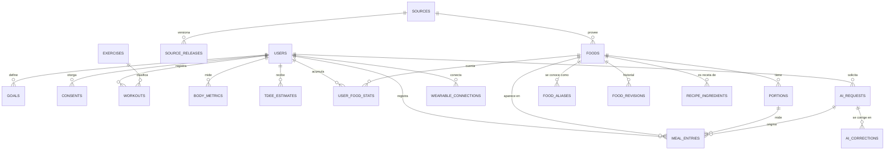
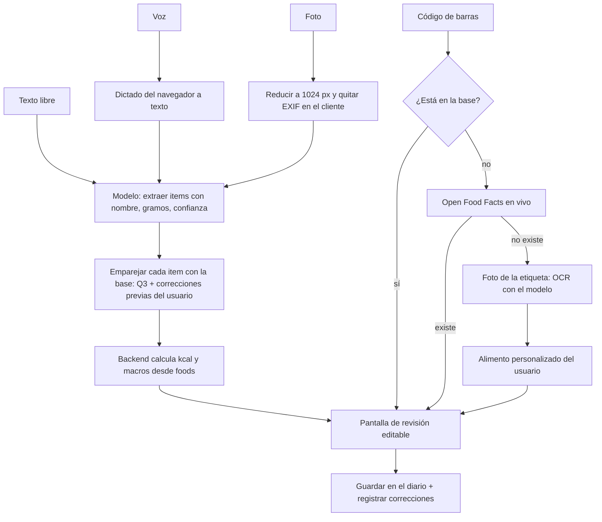

# T&M — Modelo de mejora

Fecha: 2026-11-12 · Alcance: sitio web actual (`web/`) y la app que viene después.

## Antes de empezar: qué cambié del prompt y por qué

El prompt está escrito para un producto con usuarios, métricas y app móvil. T&M no tiene ninguna de las tres cosas. Aplicarlo tal cual produce un plan para otra empresa. Ajustes:

| Parte del prompt | Problema para T&M | Qué hice |
|---|---|---|
| Contexto con campos `[...]` vacíos | Sin datos reales, el análisis se inventa | Lo llené con el estado real del repositorio (sección 0) |
| "Stack móvil: Flutter / RN / Swift" | No hay app móvil; hay un sitio estático | Capa A se plantea como PWA primero; nativo queda en "no hacer ahora" |
| "Postgres / Mongo / Firestore" | Ya decidiste SQLite | DDL y búsqueda escritos para SQLite (FTS5), con la ruta de salida a Postgres marcada |
| "Qué se rompe de 1k a 100k usuarios" | Hoy hay 0 usuarios | Lo respondo, pero corto; el riesgo real es no llegar a 100 |
| "3 experimentos A/B con tamaño muestral" | Un A/B que detecte +5 puntos de D7 necesita ~1.100 usuarios por variante | Los dejo definidos, pero propongo pruebas con 5–8 personas hasta tener tráfico |
| GDPR | Operas en Chile | Agrego Ley 19.628 y Ley 21.719 (entra en vigencia el 1 de diciembre de 2026) |
| Falta una capa | El prompt asume que existen cuentas, backend y medición | Agrego **Capa 0 — Cimientos**: sin ella nada de A–D se puede construir ni medir |
| Falta el criterio de corte | No dice cuándo parar de planificar | Cada fase tiene una condición de salida medible (sección 9) |

## 0. Supuestos y preguntas

**Hechos verificados en el repositorio**

- Estado: prototipo. Sitio estático HTML/CSS/JS sin build, 5 páginas, servido en local. No está publicado.
- Datos: 178 alimentos, 16 recetas, 173 ejercicios, escritos a mano en archivos JS (40 KB en total).
- Persistencia: `localStorage` del navegador (`tm_diary_v1`). Sin cuentas, sin backend, sin sincronización.
- Registro de comida: solo búsqueda por texto y "calorías rápidas". Foto, voz y código de barras no existen.
- Gasto por ejercicio: MET × kg × horas con ajuste por metabolismo basal.
- Meta calórica: fórmula fija (Mifflin-St Jeor × actividad × objetivo). No se adapta.
- Métricas: no se mide nada. No hay analítica ni eventos.
- Control de versiones: la carpeta no es un repositorio git.
- `BACKEND/` y `FRONT/` existen pero no se usan.

**Supuestos**

- SUPUESTO: equipo de 1 persona con asistencia de IA, dedicación parcial (~15 h/semana).
- SUPUESTO: mercado inicial Chile, idioma español.
- SUPUESTO: presupuesto de infraestructura + IA menor a USD 50/mes hasta tener usuarios.
- SUPUESTO: objetivo a 6 meses = 500 usuarios registrados, D30 ≥ 15%, registro de comida mediano < 20 s. (Lo propongo yo; no lo has definido.)
- SUPUESTO: backend Node.js + TypeScript (recomendado antes, sin confirmar).

**Preguntas** (ninguna bloquea; sigo con los supuestos)

1. ¿Chile primero, o hispanohablantes en general desde el día uno? Cambia qué tabla de alimentos importar primero.
2. ¿Hay modelo de cobro previsto (premium), o por ahora es gratis?
3. ¿Cuántas horas semanales reales hay para esto?

## 1. Diagnóstico

| # | Cuello de botella | Métrica que arruina | Razonamiento |
|---|---|---|---|
| 1 | **178 alimentos.** La búsqueda falla en la mayoría de las comidas reales | Búsquedas sin resultado; abandono en el primer registro | Un día normal en Chile incluye marraqueta, productos envasados con marca y platos preparados. Si el usuario no encuentra el segundo alimento que busca, no vuelve. Es el problema número uno, por encima de cualquier IA |
| 2 | **Sin cuentas ni sincronización.** El diario vive en un navegador | Retención D7/D30 (imposible de sostener y de medir) | Cambiar de teléfono a computador, o borrar datos del navegador, pierde todo el historial. Tampoco se puede contar usuarios |
| 3 | **Cero instrumentación** | Todas | Sin eventos no se sabe cuánto demora un registro ni dónde se abandona. Cualquier priorización posterior es opinión |
| 4 | **Registrar cuesta demasiados pasos y no hay atajos de repetición** | Segundos por registro; comidas registradas por día | Hoy: abrir modal → buscar → elegir → porción → confirmar. HIPÓTESIS: la gente repite la mayoría de sus comidas (coherente con que MyFitnessPal y MacroFactor muestren recientes y frecuentes primero). Falta "igual que ayer" en 1 toque. Además el sitio abre en una portada de marketing, no en el diario |
| 5 | **Meta calórica fija** | Retención de largo plazo (D30+) | HIPÓTESIS: las ecuaciones predictivas yerran ±10–15% por persona, varios cientos de kcal. Si el usuario cumple y no ve resultados, abandona. Va después de 1–4: sin 3 semanas de registros no hay nada que adaptar |

Lo que **no** es cuello de botella hoy: el diseño visual, el modo oscuro, la precisión de la IA (no existe) ni la escala.

## 2. Benchmark

Sin marca = comportamiento público del producto. HIPÓTESIS = mi lectura.

| Referente | Qué hace mejor | Mecanismo | Qué copiaría | Qué NO copiaría |
|---|---|---|---|---|
| **MyFitnessPal** | Cobertura: casi cualquier alimento aparece | Base alimentada por usuarios + escáner de código de barras | Recientes y frecuentes por comida; copiar comida de otro día | Entradas de usuarios sin verificar (duplicados y datos erróneos). Tampoco poner el escáner detrás del pago, como hicieron en 2022 |
| **MacroFactor** | Meta calórica que se corrige sola | Gasto estimado desde tendencia de peso + ingesta registrada; no castiga pasarse de la meta | El algoritmo adaptativo (sección 5) y el tono neutral | Solo de pago y pensado para usuarios avanzados |
| **Cronometer** | Confianza en el dato | Fuentes curadas (USDA, NCCDB) con la fuente visible en cada alimento | Mostrar procedencia; marcar entradas verificadas | Interfaz densa; micronutrientes completos son ruido para quien empieza |
| **Yazio / Lifesum** | Onboarding que convierte | Cuestionario que termina en plan y muro de pago | Mostrar la meta calculada como resultado del onboarding | Cuestionario de 20+ pantallas antes de dar valor |
| **Cal AI** | Foto como acción principal | Foto → estimación → pantalla editable | La cámara como entrada de primer nivel; resultado siempre editable | Presentar la estimación como exacta. HIPÓTESIS: el error real de porción por foto es de 20–40% y eso erosiona la confianza |
| **Fitia** | Localización LATAM | Alimentos y porciones regionales; planes de comida | El foco en alimentos locales y medidas caseras | Planes de comida completos: es otro producto, caro de hacer bien |
| **Hevy / Strong** | Registrar una serie en segundos | Muestra los valores de la sesión anterior ya puestos; rutinas guardadas | "Lo mismo que la última vez" como valor por defecto | El detalle por serie y repetición: T&M necesita gasto calórico, no progresión de fuerza |
| **Strava / Garmin / Whoop** | Registro sin esfuerzo | Captura pasiva desde reloj o sensor | A futuro: importar entrenamientos en vez de escribirlos | Integraciones ahora: mucho costo y ningún usuario que las pida |

**Hueco de diferenciación:** el contador de calorías que encuentra la comida chilena real (marraqueta, productos de supermercado local, medidas caseras) y permite repetir un día habitual en un toque, con la IA como atajo y no como promesa de exactitud.

## 3. Backlog priorizado

ICE = Impacto × Confianza × Facilidad (1–10 cada uno). Esfuerzo en días/persona.

| # | Ítem | Solución | Métrica que mueve | Impacto esperado | Esf. | Riesgo | Tipo | ICE |
|---|---|---|---|---|---|---|---|---|
| 1 | Git + publicar el sitio | `git init`, hosting estático gratuito | Habilita todo lo demás | — | 0,5 | Ninguno | Quick win | 900 |
| 2 | Abrir en el diario | Si hay datos o sesión, `/` lleva a `plan.html` | Taps hasta registrar | −1 tap | 0,5 | Ninguno | Quick win | 640 |
| 3 | Repetir comida, copiar ayer, frecuentes | Fila de frecuentes por comida; botón "Igual que ayer" | Segundos por registro | HIPÓTESIS: de ~35 s a <10 s en comidas repetidas | 3 | Bajo | Quick win | 560 |
| 4 | Eventos de uso | Tabla `events` + 8 eventos (sección 8) | Todas | Permite priorizar con datos | 2 | Bajo | Quick win | 504 |
| 5 | Importar base de alimentos abierta | USDA (genéricos) + Open Food Facts Chile (envasados) + 200 alimentos chilenos curados a mano | Búsquedas sin resultado | De HIPÓTESIS >50% a <10% | 8 | Calidad y traducción de nombres | Apuesta | 448 |
| 6 | Backend + cuentas + sincronización | API Node + SQLite; login por enlace al correo; `store.js` pasa a llamar la API | D7, D30 | Requisito para retener | 10 | Seguridad de sesión | Apuesta | 400 |
| 7 | Código de barras | Cámara del navegador + Open Food Facts; si no existe, foto de la etiqueta | Segundos por registro | <8 s en envasados | 4 | HIPÓTESIS: cobertura parcial de OFF en Chile | Quick win tras 5 y 6 | 392 |
| 8 | Texto libre con IA | Claude extrae alimentos + gramos; el backend calcula desde la base propia | Comidas por día | 1 frase = 1 comida completa | 5 | Costo; errores de porción | Apuesta | 343 |
| 9 | PWA instalable + offline | Manifest + service worker + cola local | D7 | Ícono en la pantalla de inicio | 5 | Sincronización | Apuesta | 240 |
| 10 | Meta adaptativa | Algoritmo de la sección 5 | D30+ | Solo sirve con ≥3 semanas de datos | 6 | Datos incompletos | Apuesta | 216 |
| 11 | Foto con IA | Mismo pipeline que texto, con imagen | Comidas por día | Medir el error real antes de promocionarlo | 6 | Error de porción alto | Apuesta | 200 |

**NO HACER AHORA**

| Descartado | Por qué |
|---|---|
| App nativa (Swift, Kotlin, Flutter) | Duplica el trabajo de una persona. La PWA cubre cámara, micrófono e instalación. Revisar con más de 1.000 usuarios activos |
| Modelo de visión propio | Necesita miles de fotos etiquetadas y mantenimiento. Una API da mejor resultado desde el día uno |
| Wearables | Apple Health exige app nativa; nadie lo ha pedido |
| Planes de comida generados | Otro producto. Compite con Fitia en su terreno |
| Rachas, medallas, funciones sociales | Las rachas castigan el día sin registrar, contrario al principio "sin culpa" |
| Micronutrientes completos | Las fuentes abiertas tienen muchos vacíos; mostrarlos incompletos resta confianza |
| Migrar a Postgres | SQLite aguanta de sobra la escala de los próximos 12 meses |
| Más rediseño visual | Ya está bien. No mueve ninguna métrica del diagnóstico |

## Capa 0 — Cimientos (lo que el prompt no pide y bloquea todo)

1. `git init`, primer commit, repositorio remoto privado. Hoy un error borra el trabajo.
2. Sacar el proyecto de OneDrive o excluir `node_modules` y la base: OneDrive sincroniza miles de archivos y bloquea los que SQLite tiene abiertos.
3. Estructura: `web/` (cliente), `BACKEND/` (API + SQLite), `data/` (scripts de importación). Borrar `FRONT/` si está vacío.
4. Publicar `web/` en un hosting estático para probarlo en teléfonos reales.
5. Un solo punto de cambio en el cliente: `web/assets/js/store.js` ya está diseñado para eso. Las páginas no se tocan.

## 4. Capa C — Datos

Decisiones de base:

- SQLite en modo WAL, tablas `STRICT`, claves foráneas activadas.
- Todo identificador que nace en el cliente es un UUID generado en el cliente. Así reintentar un envío es inofensivo.
- Nutrientes guardados **por 100 g**; las porciones solo convierten a gramos. El registro guarda además una **copia de los valores calculados**: si mañana se corrige un alimento, el historial del usuario no cambia.
- Días de diario como texto `YYYY-MM-DD` en hora local del usuario (un día de diario no es un instante UTC). Marcas de tiempo en milisegundos UTC.

### 4.1 DDL (SQLite ≥ 3.45)

```sql
PRAGMA journal_mode = WAL;
PRAGMA foreign_keys = ON;

-- ---------- Usuarios ----------
CREATE TABLE users (
  id            TEXT PRIMARY KEY,                 -- uuid
  email         TEXT NOT NULL UNIQUE COLLATE NOCASE,
  display_name  TEXT,
  locale        TEXT NOT NULL DEFAULT 'es-CL',
  region        TEXT NOT NULL DEFAULT 'CL',
  timezone      TEXT NOT NULL DEFAULT 'America/Santiago',
  sex           TEXT CHECK (sex IN ('f','m')),    -- solo para la fórmula inicial
  birth_year    INTEGER,                          -- año, no fecha: minimización
  height_cm     REAL,
  created_at    INTEGER NOT NULL,
  deleted_at    INTEGER                           -- borrado lógico; purga a 30 días
) STRICT;

CREATE TABLE consents (
  user_id     TEXT NOT NULL REFERENCES users(id) ON DELETE CASCADE,
  purpose     TEXT NOT NULL,      -- 'health_data' | 'ai_photo' | 'analytics'
  version     TEXT NOT NULL,      -- versión del texto aceptado
  granted_at  INTEGER NOT NULL,
  revoked_at  INTEGER,
  PRIMARY KEY (user_id, purpose, version)
) STRICT;

CREATE TABLE sessions (
  token_hash  TEXT PRIMARY KEY,   -- sha256 del token; nunca el token
  user_id     TEXT NOT NULL REFERENCES users(id) ON DELETE CASCADE,
  device_id   TEXT NOT NULL,
  expires_at  INTEGER NOT NULL
) STRICT;

CREATE TABLE goals (                -- historial: una fila por cambio de meta
  id          TEXT PRIMARY KEY,
  user_id     TEXT NOT NULL REFERENCES users(id) ON DELETE CASCADE,
  valid_from  TEXT NOT NULL,        -- YYYY-MM-DD
  objective   TEXT NOT NULL CHECK (objective IN ('perder','mantener','ganar')),
  kcal        INTEGER NOT NULL,
  protein_g   INTEGER NOT NULL,
  carbs_g     INTEGER NOT NULL,
  fat_g       INTEGER NOT NULL,
  source      TEXT NOT NULL CHECK (source IN ('formula','adaptive','manual')),
  updated_at  INTEGER NOT NULL
) STRICT;
CREATE INDEX goals_user_date ON goals(user_id, valid_from DESC);

-- ---------- Procedencia ----------
CREATE TABLE sources (
  id           INTEGER PRIMARY KEY,
  code         TEXT NOT NULL UNIQUE,   -- 'usda_fdc' | 'off' | 'tm_curated' | 'user'
  name         TEXT NOT NULL,
  license      TEXT NOT NULL,          -- 'CC0' | 'ODbL-1.0' | 'propia'
  attribution  TEXT,                   -- texto que se muestra en la ficha
  url          TEXT
) STRICT;

CREATE TABLE source_releases (         -- cada importación es una versión
  id           INTEGER PRIMARY KEY,
  source_id    INTEGER NOT NULL REFERENCES sources(id),
  version      TEXT NOT NULL,          -- p. ej. '2026-10' o hash del volcado
  imported_at  INTEGER NOT NULL,
  row_count    INTEGER NOT NULL,
  UNIQUE (source_id, version)
) STRICT;

-- ---------- Alimentos ----------
CREATE TABLE foods (
  id            INTEGER PRIMARY KEY,
  slug          TEXT NOT NULL UNIQUE,
  kind          TEXT NOT NULL CHECK (kind IN ('generic','branded','recipe','custom')),
  name          TEXT NOT NULL,
  brand         TEXT,
  category      TEXT,
  icon          TEXT,
  barcode       TEXT,                    -- EAN/UPC
  source_id     INTEGER NOT NULL REFERENCES sources(id),
  release_id    INTEGER REFERENCES source_releases(id),
  external_id   TEXT,                    -- id en la fuente original
  owner_user_id TEXT REFERENCES users(id) ON DELETE CASCADE,  -- solo 'custom'
  verified      INTEGER NOT NULL DEFAULT 0,   -- revisado por T&M
  region        TEXT,                    -- 'CL' si es específico del país
  popularity    INTEGER NOT NULL DEFAULT 0,   -- registros de los últimos 90 días
  -- por 100 g (o 100 ml si is_liquid)
  kcal REAL NOT NULL, protein_g REAL NOT NULL, carbs_g REAL NOT NULL, fat_g REAL NOT NULL,
  fiber_g REAL, sugar_g REAL, sat_fat_g REAL, sodium_mg REAL,
  is_liquid     INTEGER NOT NULL DEFAULT 0,
  revision      INTEGER NOT NULL DEFAULT 1,
  updated_at    INTEGER NOT NULL,
  deleted_at    INTEGER,
  CHECK (kcal >= 0 AND kcal <= 900),
  CHECK (protein_g + carbs_g + fat_g <= 101)
) STRICT;
CREATE UNIQUE INDEX foods_barcode ON foods(barcode) WHERE barcode IS NOT NULL AND deleted_at IS NULL;
CREATE UNIQUE INDEX foods_external ON foods(source_id, external_id) WHERE external_id IS NOT NULL;
CREATE INDEX foods_category_pop ON foods(category, popularity DESC) WHERE deleted_at IS NULL;
CREATE INDEX foods_owner ON foods(owner_user_id) WHERE owner_user_id IS NOT NULL;

CREATE TABLE food_revisions (           -- historial de cambios de valores
  food_id    INTEGER NOT NULL REFERENCES foods(id),
  revision   INTEGER NOT NULL,
  snapshot   TEXT NOT NULL,             -- JSON de los valores anteriores
  reason     TEXT,
  changed_at INTEGER NOT NULL,
  PRIMARY KEY (food_id, revision)
) STRICT;

CREATE TABLE food_aliases (             -- sinónimos e idiomas
  food_id  INTEGER NOT NULL REFERENCES foods(id) ON DELETE CASCADE,
  alias    TEXT NOT NULL,               -- 'aguacate' -> Palta; 'banana' -> Plátano
  locale   TEXT NOT NULL DEFAULT 'es',
  PRIMARY KEY (food_id, alias, locale)
) STRICT, WITHOUT ROWID;

CREATE TABLE portions (
  id         INTEGER PRIMARY KEY,
  food_id    INTEGER NOT NULL REFERENCES foods(id) ON DELETE CASCADE,
  label      TEXT NOT NULL,             -- 'unidad', 'taza', 'rebanada'
  grams      REAL NOT NULL CHECK (grams > 0),
  is_default INTEGER NOT NULL DEFAULT 0,
  sort       INTEGER NOT NULL DEFAULT 0,
  UNIQUE (food_id, label)
) STRICT;

CREATE TABLE recipe_ingredients (       -- receta = food con kind='recipe'
  recipe_id  INTEGER NOT NULL REFERENCES foods(id) ON DELETE CASCADE,
  food_id    INTEGER NOT NULL REFERENCES foods(id),
  grams      REAL NOT NULL,
  sort       INTEGER NOT NULL DEFAULT 0,
  PRIMARY KEY (recipe_id, food_id)
) STRICT, WITHOUT ROWID;

-- ---------- Búsqueda ----------
-- Tabla 1: palabras completas y prefijos, sin tildes.
CREATE VIRTUAL TABLE food_fts USING fts5(
  name, brand, aliases,
  content='', contentless_delete=1,
  tokenize = "unicode61 remove_diacritics 2",
  prefix = '2 3'
);
-- Tabla 2: trigramas; tolera errores de tipeo ('platno' -> plátano).
CREATE VIRTUAL TABLE food_trgm USING fts5(
  name, content='', contentless_delete=1,
  tokenize = "trigram remove_diacritics 1"
);

-- ---------- Diario ----------
CREATE TABLE meal_entries (
  id           TEXT PRIMARY KEY,         -- uuid del cliente
  user_id      TEXT NOT NULL REFERENCES users(id) ON DELETE CASCADE,
  day          TEXT NOT NULL,            -- YYYY-MM-DD local
  meal         TEXT NOT NULL CHECK (meal IN ('desayuno','almuerzo','cena','snacks')),
  food_id      INTEGER REFERENCES foods(id),   -- NULL en 'calorías rápidas'
  food_rev     INTEGER,
  label        TEXT NOT NULL,            -- nombre mostrado, congelado
  portion_id   INTEGER REFERENCES portions(id),
  quantity     REAL NOT NULL DEFAULT 1,
  grams        REAL,
  -- copia congelada de lo calculado al registrar
  kcal REAL NOT NULL, protein_g REAL NOT NULL, carbs_g REAL NOT NULL, fat_g REAL NOT NULL,
  input_method TEXT NOT NULL CHECK (input_method IN
                 ('search','recent','repeat','barcode','text_ai','photo_ai','voice_ai','quick')),
  ai_request_id TEXT,                    -- enlaza con ai_requests
  created_at   INTEGER NOT NULL,
  updated_at   INTEGER NOT NULL,
  deleted_at   INTEGER,
  server_seq   INTEGER NOT NULL          -- contador global, para sincronizar
) STRICT;
CREATE INDEX me_user_day  ON meal_entries(user_id, day) WHERE deleted_at IS NULL;
CREATE INDEX me_user_seq  ON meal_entries(user_id, server_seq);

CREATE TABLE user_food_stats (           -- ranking personal; lo mantiene el servidor al registrar
  user_id      TEXT NOT NULL REFERENCES users(id) ON DELETE CASCADE,
  food_id      INTEGER NOT NULL REFERENCES foods(id),
  meal         TEXT NOT NULL,
  uses         INTEGER NOT NULL DEFAULT 0,
  last_used_at INTEGER NOT NULL,
  last_portion_id INTEGER, last_quantity REAL, last_grams REAL,
  PRIMARY KEY (user_id, food_id, meal)
) STRICT, WITHOUT ROWID;
CREATE INDEX ufs_recent ON user_food_stats(user_id, meal, last_used_at DESC);

CREATE TABLE day_status (                -- ¿día completo? clave para la meta adaptativa
  user_id  TEXT NOT NULL REFERENCES users(id) ON DELETE CASCADE,
  day      TEXT NOT NULL,
  complete INTEGER NOT NULL DEFAULT 0,   -- lo marca el usuario o una regla
  PRIMARY KEY (user_id, day)
) STRICT, WITHOUT ROWID;

-- ---------- Ejercicio ----------
CREATE TABLE exercises (
  id       INTEGER PRIMARY KEY,
  slug     TEXT NOT NULL UNIQUE,
  name     TEXT NOT NULL,
  category TEXT NOT NULL,
  met      REAL NOT NULL CHECK (met BETWEEN 1 AND 25),
  icon     TEXT
) STRICT;

CREATE TABLE workouts (
  id          TEXT PRIMARY KEY,
  user_id     TEXT NOT NULL REFERENCES users(id) ON DELETE CASCADE,
  day         TEXT NOT NULL,
  exercise_id INTEGER REFERENCES exercises(id),
  label       TEXT NOT NULL,
  minutes     REAL NOT NULL CHECK (minutes > 0),
  kcal        REAL NOT NULL,
  kcal_source TEXT NOT NULL CHECK (kcal_source IN ('met','wearable','manual')),
  weight_kg_used REAL,                   -- peso con que se calculó
  external_id TEXT,                      -- id en el wearable; evita duplicados
  created_at  INTEGER NOT NULL, updated_at INTEGER NOT NULL, deleted_at INTEGER,
  server_seq  INTEGER NOT NULL
) STRICT;
CREATE INDEX wo_user_day ON workouts(user_id, day) WHERE deleted_at IS NULL;
CREATE UNIQUE INDEX wo_external ON workouts(user_id, external_id) WHERE external_id IS NOT NULL;

-- ---------- Peso y métricas ----------
CREATE TABLE body_metrics (
  user_id    TEXT NOT NULL REFERENCES users(id) ON DELETE CASCADE,
  day        TEXT NOT NULL,
  metric     TEXT NOT NULL CHECK (metric IN ('weight_kg','waist_cm','body_fat_pct','steps')),
  value      REAL NOT NULL,
  source     TEXT NOT NULL DEFAULT 'manual',
  updated_at INTEGER NOT NULL,
  deleted_at INTEGER,
  server_seq INTEGER NOT NULL,
  PRIMARY KEY (user_id, metric, day)
) STRICT, WITHOUT ROWID;

CREATE TABLE tdee_estimates (            -- salida del motor adaptativo, una por día
  user_id      TEXT NOT NULL REFERENCES users(id) ON DELETE CASCADE,
  day          TEXT NOT NULL,
  trend_weight REAL,
  tdee_kcal    REAL NOT NULL,
  confidence   REAL NOT NULL,            -- 0..1
  days_used    INTEGER NOT NULL,
  PRIMARY KEY (user_id, day)
) STRICT, WITHOUT ROWID;

-- ---------- Wearables (esquema listo, sin implementar) ----------
CREATE TABLE wearable_connections (
  id          TEXT PRIMARY KEY,
  user_id     TEXT NOT NULL REFERENCES users(id) ON DELETE CASCADE,
  provider    TEXT NOT NULL,             -- 'garmin' | 'strava' | 'health_connect'
  token_enc   BLOB NOT NULL,             -- cifrado con clave del servidor
  last_sync_at INTEGER,
  UNIQUE (user_id, provider)
) STRICT;

CREATE TABLE wearable_daily (
  user_id     TEXT NOT NULL REFERENCES users(id) ON DELETE CASCADE,
  provider    TEXT NOT NULL,
  day         TEXT NOT NULL,
  active_kcal REAL, resting_kcal REAL, steps INTEGER,
  PRIMARY KEY (user_id, provider, day)
) STRICT, WITHOUT ROWID;

-- ---------- IA ----------
CREATE TABLE ai_requests (
  id           TEXT PRIMARY KEY,
  user_id      TEXT NOT NULL REFERENCES users(id) ON DELETE CASCADE,
  kind         TEXT NOT NULL CHECK (kind IN ('text','photo','voice','label_ocr')),
  model        TEXT NOT NULL,
  status       TEXT NOT NULL CHECK (status IN ('queued','done','failed')),
  input_tokens INTEGER, output_tokens INTEGER, cost_usd REAL, latency_ms INTEGER,
  result_json  TEXT,                     -- lo que propuso la IA
  created_at   INTEGER NOT NULL
) STRICT;
CREATE INDEX ai_user_day ON ai_requests(user_id, created_at);

CREATE TABLE ai_corrections (            -- qué cambió el usuario respecto a la propuesta
  id            INTEGER PRIMARY KEY,
  ai_request_id TEXT NOT NULL REFERENCES ai_requests(id) ON DELETE CASCADE,
  user_id       TEXT NOT NULL,
  heard_as      TEXT NOT NULL,           -- texto que usó la IA: 'pan con palta'
  proposed_food_id INTEGER, proposed_grams REAL,
  final_food_id INTEGER,    final_grams REAL,
  action        TEXT NOT NULL CHECK (action IN
                  ('accepted','food_changed','grams_changed','removed','added'))
) STRICT;
CREATE INDEX aic_user_heard ON ai_corrections(user_id, heard_as);

-- ---------- Sincronización y medición ----------
CREATE TABLE sync_ops (                  -- cada operación del cliente se aplica una sola vez
  op_id      TEXT PRIMARY KEY,           -- uuid generado en el cliente
  user_id    TEXT NOT NULL,
  device_id  TEXT NOT NULL,
  applied_at INTEGER NOT NULL,
  result     TEXT NOT NULL               -- 'applied' | 'stale' | 'rejected'
) STRICT, WITHOUT ROWID;

CREATE TABLE events (                    -- analítica propia, sin terceros
  id        INTEGER PRIMARY KEY,
  user_id   TEXT,                        -- NULL = anónimo
  device_id TEXT NOT NULL,
  name      TEXT NOT NULL,
  props     TEXT,                        -- JSON pequeño, sin datos de salud
  ts        INTEGER NOT NULL
) STRICT;
CREATE INDEX ev_name_ts ON events(name, ts);
CREATE INDEX ev_user_ts ON events(user_id, ts);
```

Verificado el 2026-11-12: el DDL se crea sin errores en SQLite 3.50.4 y las 10 consultas de 4.7 compilan contra él. No está probado con datos ni medido su rendimiento.

### 4.2 Índices: por qué cada uno

| Índice | Consulta que sirve | Por qué así |
|---|---|---|
| `me_user_day` (parcial) | Pantalla "Hoy" y rangos del progreso | Es la consulta más frecuente. Parcial para que los borrados no ocupen el índice |
| `me_user_seq` | Descargar cambios desde la última sincronización | Recorre solo lo nuevo, en orden |
| `ufs_recent` | "Recientes" por comida | Evita ordenar todo el historial cada vez que se abre el modal |
| `foods_barcode` (único parcial) | Escaneo | Búsqueda exacta; único para impedir duplicados de un mismo producto |
| `foods_external` | Reimportar una fuente | Permite actualizar en vez de duplicar |
| `foods_category_pop` | Explorar por categoría, por popularidad | Devuelve la página ya ordenada |
| `ev_name_ts` | Embudos y métricas | Los KPI filtran por evento y fecha |

Lo que **no** indexo: `foods(name)`. La búsqueda por nombre va por FTS; un índice normal sobre el nombre no sirve para "contiene" ni para tildes.

### 4.3 Estrategia de búsqueda

1. **Normalizar** la consulta: minúsculas, sin tildes, sin plurales simples (`huevos` → `huevo`).
2. **Sinónimos**: `food_aliases` se indexa dentro de `food_fts.aliases`. Así `aguacate`, `banana`, `fresa`, `maíz` llegan a Palta, Plátano, Frutilla y Choclo sin lógica extra.
3. **Dos pasadas**:
   - Prefijo en `food_fts` (`"pla"*`). Es instantánea y cubre la gran mayoría de los casos.
   - Solo si devuelve menos de 5 resultados: trigramas en `food_trgm`, para tolerar errores de tipeo.
4. **Orden final** (consulta Q3):

```
puntaje = relevancia de texto (bm25)
        + 3.0 × el usuario ya lo registró
        + 1.0 × ln(1 + popularidad)
        + 0.5 × verificado
        + 0.5 × es de la región del usuario
```

   El peso mayor es el uso personal: lo que esa persona come importa más que lo popular. Los pesos son un punto de partida (SUPUESTO); se ajustan con el evento `search_result_pick` (qué posición eligió el usuario).
5. **Sin resultado**: se guarda `search_no_result` con el texto buscado. Esa lista es la cola de trabajo para agregar alimentos y la forma más barata de saber qué falta.

Trade-off: los trigramas agrandan la base (HIPÓTESIS: ~3× el texto indexado). Con 300 mil alimentos sigue por debajo de 1 GB.

### 4.4 Versionado, licencias y procedencia

| Fuente | Qué aporta | Licencia | Obligación | Actualización |
|---|---|---|---|---|
| USDA FoodData Central | Genéricos con datos de laboratorio | Dominio público (CC0) | Ninguna; citar por cortesía | Semestral; reimportar por `external_id` |
| Open Food Facts | Envasados con código de barras | ODbL | Atribuir, y **compartir bajo la misma licencia las mejoras hechas a esos datos** | Volcado mensual filtrado por país |
| Curada T&M | Alimentos chilenos, medidas caseras, traducciones | Propia | — | Continua, guiada por las búsquedas sin resultado |
| Usuario | Alimentos personalizados | Del usuario | Visibles solo para quien los creó | — |

Reglas:

- **ODbL obliga.** Mantener los datos de Open Food Facts identificables (`source_id`) y separados de la capa curada. Las correcciones propias a un producto de OFF se guardan como fila nueva `tm_curated` que lo reemplaza en la búsqueda, no como edición de la fila original. Confirmar el alcance de la obligación con un abogado antes de cobrar por el producto.
- SUPUESTO: las tablas chilenas de composición de alimentos (INTA / Universidad de Chile) no tienen licencia abierta, así que no se copian en bloque. Se usan como referencia para curar a mano, citando la fuente.
- Cada cambio de valores sube `foods.revision` y guarda el estado anterior en `food_revisions`. El registro del diario guarda `food_rev` y su propia copia de kcal: **el historial nunca se recalcula solo**.
- Control de calidad al importar: descartar filas donde `4·proteína + 4·carbohidratos + 9·grasa` difiera más de 25% de las kcal declaradas. HIPÓTESIS: elimina 5–15% de Open Food Facts, que es justo la parte dañina.
- La ficha del alimento muestra la fuente: "USDA", "Open Food Facts" o "Verificado por T&M".

### 4.5 Sincronización offline-first

El cliente guarda cada cambio en una cola local y la envía cuando hay conexión. El servidor es la autoridad.

```
Operación del cliente:
{ op_id: uuid, device_id, entity: 'meal_entry', entity_id: uuid,
  type: 'upsert' | 'delete', data: {...}, client_ts: ms }

POST /v1/sync  { since_seq: 1841, ops: [ ... ] }
→ { applied: [op_id...], stale: [op_id...],
    changes: [ filas con server_seq > 1841 ], next_seq: 1903 }
```

| Tema | Regla |
|---|---|
| Idempotencia | `sync_ops.op_id` es clave primaria. Una operación repetida recibe el resultado guardado y no se aplica de nuevo |
| Identificadores | UUID del cliente: crear dos veces la misma fila es un `upsert` inofensivo |
| Conflictos | Gana la última escritura **por fila**, según `updated_at`. Basta: un diario lo edita una persona, casi nunca en dos dispositivos a la vez. Excepción: un borrado gana sobre una edición anterior o simultánea |
| Reloj del cliente incorrecto | El servidor recorta `client_ts` a su propia hora si viene del futuro |
| Borrado | Lógico (`deleted_at`). Las filas borradas viajan en `changes` para que los otros dispositivos las quiten. Purga física a los 90 días |
| Orden | `server_seq` es un contador único y creciente. El cliente solo recuerda el último número recibido |
| Sin conexión | El cliente calcula kcal con un subconjunto en caché: sus alimentos usados + los 2.000 más populares (HIPÓTESIS: ~1 MB) |
| Exportación | `GET /v1/me/export`: JSON + CSV con perfil, diario, peso, entrenamientos, consentimientos y solicitudes de IA |
| Eliminar cuenta | `deleted_at` inmediato y sesiones revocadas; borrado físico en cascada a los 30 días; `events` queda anónimo (`user_id = NULL`) |

Descarto CRDT y la fusión campo a campo: resuelven la edición simultánea, que aquí no ocurre, y multiplican la complejidad.

### 4.6 Diagrama entidad-relación



### 4.7 Consultas reales

**Q1 — Pantalla "Hoy".**
```sql
SELECT id, meal, label, quantity, grams, kcal, protein_g, carbs_g, fat_g, food_id, portion_id
FROM meal_entries
WHERE user_id = ?1 AND day = ?2 AND deleted_at IS NULL
ORDER BY meal, created_at;
```
Plan: búsqueda directa en `me_user_day`; lee 5–20 filas. Los totales se suman en el cliente; no merece otra consulta.

**Q2 — Recientes y frecuentes para una comida** (lo primero que muestra el modal de agregar).
```sql
SELECT f.id, f.name, f.icon, s.last_portion_id, s.last_quantity, s.last_grams, s.uses
FROM user_food_stats s JOIN foods f ON f.id = s.food_id
WHERE s.user_id = ?1 AND s.meal = ?2 AND f.deleted_at IS NULL
ORDER BY s.last_used_at DESC
LIMIT 12;
```
Plan: recorre `ufs_recent` ya ordenado y corta en 12. Sin esta tabla habría que agrupar todo el historial del usuario cada vez.

**Q3 — Búsqueda con ranking personal.**
```sql
WITH hits AS (
  SELECT rowid AS food_id, bm25(food_fts, 10.0, 3.0, 5.0) AS rank  -- nombre pesa más que marca
  FROM food_fts WHERE food_fts MATCH ?1                            -- p. ej. '"pan"* "integral"*'
  ORDER BY rank LIMIT 200
)
SELECT f.id, f.name, f.brand, f.icon, f.kcal, f.verified,
       (-h.rank)
       + 3.0 * (s.uses IS NOT NULL)
       + 1.0 * ln(1 + f.popularity)
       + 0.5 * f.verified
       + 0.5 * (f.region IS ?3) AS score
FROM hits h
JOIN foods f ON f.id = h.food_id AND f.deleted_at IS NULL
           AND (f.owner_user_id IS NULL OR f.owner_user_id = ?2)
LEFT JOIN (SELECT food_id, SUM(uses) AS uses FROM user_food_stats
           WHERE user_id = ?2 GROUP BY food_id) s ON s.food_id = f.id
ORDER BY score DESC
LIMIT 20;
```
Plan: FTS entrega como máximo 200 candidatos; el resto son búsquedas por clave primaria. El `LIMIT 200` interno mantiene el costo fijo aunque la consulta sea una sola letra. `bm25` devuelve valores negativos (menor = mejor), por eso se invierte.

**Q4 — Tolerancia a errores de tipeo** (solo si Q3 trae menos de 5).
```sql
SELECT f.id, f.name FROM food_trgm t JOIN foods f ON f.id = t.rowid
WHERE food_trgm MATCH ?1 AND f.deleted_at IS NULL
ORDER BY rank LIMIT 10;
```
Plan: índice de trigramas. Necesita una consulta de al menos 3 caracteres.

**Q5 — Código de barras.**
```sql
SELECT f.*, p.id AS portion_id, p.label, p.grams
FROM foods f LEFT JOIN portions p ON p.food_id = f.id AND p.is_default = 1
WHERE f.barcode = ?1 AND f.deleted_at IS NULL;
```
Plan: una búsqueda en el índice único. Si no hay fila: consultar Open Food Facts en vivo y guardar el producto.

**Q6 — "Igual que ayer": copiar una comida.**
```sql
INSERT INTO meal_entries (id, user_id, day, meal, food_id, food_rev, label, portion_id, quantity,
                          grams, kcal, protein_g, carbs_g, fat_g, input_method,
                          created_at, updated_at, server_seq)
SELECT lower(hex(randomblob(16))), user_id, ?3, meal, food_id, food_rev, label, portion_id, quantity,
       grams, kcal, protein_g, carbs_g, fat_g, 'repeat', ?4, ?4, ?5
FROM meal_entries
WHERE user_id = ?1 AND day = ?2 AND meal = ?6 AND deleted_at IS NULL;
```
Plan: lectura por `me_user_day`. En la práctica el cliente genera los UUID y lo envía como operaciones normales, para que funcione sin conexión; esta versión es la del servidor.

**Q7 — Totales diarios para el gráfico de progreso.**
```sql
SELECT day, SUM(kcal) AS kcal, SUM(protein_g) AS p, SUM(carbs_g) AS c, SUM(fat_g) AS f, COUNT(*) AS n
FROM meal_entries
WHERE user_id = ?1 AND day BETWEEN ?2 AND ?3 AND deleted_at IS NULL
GROUP BY day;
```
Plan: recorrido de rango en `me_user_day`. El índice ya viene ordenado por día, así que agrupa sin ordenar. Unas 300 filas por usuario al mes.

**Q8 — Entrada del motor adaptativo** (ingesta de días completos + peso).
```sql
SELECT d.day, d.kcal, w.value AS weight_kg
FROM (SELECT m.day, SUM(m.kcal) AS kcal
      FROM meal_entries m JOIN day_status s
        ON s.user_id = m.user_id AND s.day = m.day AND s.complete = 1
      WHERE m.user_id = ?1 AND m.day >= ?2 AND m.deleted_at IS NULL
      GROUP BY m.day) d
LEFT JOIN body_metrics w
  ON w.user_id = ?1 AND w.metric = 'weight_kg' AND w.day = d.day AND w.deleted_at IS NULL;
```
Plan: rango por `me_user_day`; `day_status` y `body_metrics` se resuelven por clave primaria. Corre una vez al día por usuario, no en cada pantalla.

**Q9 — Descargar cambios desde la última sincronización.**
```sql
SELECT * FROM meal_entries WHERE user_id = ?1 AND server_seq > ?2 ORDER BY server_seq LIMIT 500;
```
Plan: rango en `me_user_seq`. Incluye las filas borradas, a propósito. Se repite para `workouts` y `body_metrics`.

**Q10 — Cola de trabajo de la base: qué se busca y no se encuentra.**
```sql
SELECT json_extract(props, '$.q') AS q, COUNT(*) AS veces, COUNT(DISTINCT device_id) AS personas
FROM events
WHERE name = 'search_no_result' AND ts >= ?1
GROUP BY q ORDER BY personas DESC, veces DESC LIMIT 100;
```
Plan: rango en `ev_name_ts`. Es una consulta de administración semanal. Ordena por personas distintas para que un solo usuario insistente no domine la lista.

### 4.8 Cuándo dejar SQLite

SQLite admite un solo escritor a la vez. Con WAL y escrituras cortas eso alcanza para decenas de miles de usuarios activos diarios (HIPÓTESIS; depende del disco). Señales para migrar a Postgres: errores `SQLITE_BUSY` frecuentes, necesidad de más de un servidor de aplicación, o exigencia de recuperación a un punto en el tiempo. Para que migrar sea barato: nada de SQL exclusivo de SQLite fuera de la búsqueda, que es lo único que habría que reescribir.

Respaldo desde el día uno: copia cada hora a almacenamiento externo (Litestream o `sqlite3 .backup`). Son datos de salud.

## 5. Capa D — IA y motor de cálculo

### 5.1 Regla de diseño

**La IA nunca entrega calorías.** Entrega una lista de alimentos con gramos estimados. El backend busca cada alimento en la base propia y calcula kcal y macros con los mismos valores que usa el resto de la app. Consecuencias:

- Un número inventado por el modelo no puede llegar al diario.
- La misma comida da el mismo resultado por foto, por texto o a mano.
- Lo que el usuario corrige es el alimento o los gramos, dos cosas que entiende.

### 5.2 Pipeline



Salida exigida al modelo (salida estructurada con esquema JSON):

```json
{
  "items": [
    { "name": "arroz blanco cocido", "grams": 180, "confidence": 0.7,
      "portion_hint": "1 taza", "alternatives": ["arroz integral cocido"] }
  ],
  "is_food": true,
  "notes": "No se ve si la ensalada lleva aceite"
}
```

Detalles que importan:

- **Aceites y salsas ocultas** son la mayor fuente de error por foto. El modelo debe listar lo que no puede ver en `notes`, y la pantalla de revisión pregunta: "¿Lleva aceite o aliño?" con un toque para agregarlo.
- **Emparejamiento**: primero se consultan las correcciones previas de ese usuario (`ai_corrections.heard_as`). Si la última vez cambió "pan" por "marraqueta", ahora se propone marraqueta.
- **Porción**: si el modelo da `portion_hint` y existe esa porción en la base, se usan los gramos de la base, no los del modelo.
- **Sin coincidencia en la base**: el ítem aparece en la revisión como "No lo encontré" con buscador abierto. No se inventan valores.
- **Voz**: el dictado del navegador es gratis pero no funciona en todos (SUPUESTO: Firefox no lo soporta). Si no está disponible, se oculta el botón.

### 5.3 Tres opciones

Costos como órdenes de magnitud. SUPUESTO en todas las cifras: hay que recalcular con la lista de precios vigente antes de decidir.

| Criterio | Modelo propio | API de terceros (Claude) | Híbrido |
|---|---|---|---|
| Qué es | Detector entrenado con fotos propias | Una llamada por registro; emparejamiento y cálculo en el backend | API para foto y texto; reglas locales para lo repetido |
| Costo por 1.000 registros | Bajo en uso; alto fijo (servidor con GPU) | Texto: centavos a pocos dólares. Foto: unos pocos dólares a ~USD 20 según modelo | 30–60% menos que API pura, porque lo repetido no llama al modelo |
| Latencia p95 | <1 s | 3–8 s | Igual a API cuando llama; instantáneo cuando no |
| Error esperado (kcal por plato) | HIPÓTESIS: 30–50% sin miles de fotos locales | HIPÓTESIS: 20–35% por foto; 10–20% por texto con cantidades | Igual a API; baja con las correcciones |
| Esfuerzo | Meses + etiquetado continuo | 5–8 días | 8–12 días |
| Dependencia | Ninguna | Alta: precio y disponibilidad | Media: el emparejamiento y los datos son propios |

**Elección: API ahora, con el diseño ya preparado para híbrido.** Con una persona y cero fotos etiquetadas, el modelo propio no es viable. La dependencia se limita con tres decisiones: el modelo solo identifica (el valor está en la base propia), toda llamada pasa por una función única `identifyFoods()` que se puede cambiar de proveedor, y `ai_corrections` acumula datos propios que sirven con cualquier modelo.

Qué modelo: no se decide por intuición. Se corre el set de evaluación (5.4) con el modelo más capaz y con uno más barato; se usa el más barato que pase el criterio de aceptación.

### 5.4 Plan de evaluación

| Elemento | Definición |
|---|---|
| Set de test | 150 platos: 60 comidas caseras chilenas, 30 platos de restaurante o casino, 30 desayunos y onces, 30 envasados fuera del empaque. Cada uno con foto + descripción en texto |
| Cómo etiquetarlo | Pesar cada componente en una balanza de cocina antes de fotografiar. Es lento (HIPÓTESIS: 5 min por plato, ~13 horas en total), pero sin gramos reales no hay nada que medir |
| Condiciones | Tercio con buena luz, tercio con luz de interior, tercio en ángulo incómodo. Fotos tomadas con teléfono de gama media |
| Acierto de alimento | Top-1: el propuesto es el correcto. Top-5: el correcto está entre el propuesto y sus alternativas |
| Error de porción | Error porcentual absoluto medio de los gramos, solo en alimentos bien identificados |
| Error de kcal | MAE en kcal por plato y error porcentual mediano |
| Costo y latencia | Costo medio por solicitud y p95 |

Criterio de aceptación para lanzar la foto (SUPUESTO; ajustar con los primeros resultados):

- Top-1 ≥ 70% y top-5 ≥ 90%.
- Error porcentual mediano de kcal ≤ 25%.
- Ningún caso donde algo que no es comida produzca un registro.
- Texto libre con cantidades explícitas: error mediano ≤ 10%.

Si la foto no pasa, se lanza solo texto y código de barras. El set se vuelve a correr ante cada cambio de modelo o de instrucciones.

### 5.5 Fallback y aprendizaje

- **Revisión obligatoria**: nada entra al diario sin que el usuario toque "Agregar". Cada ítem se puede cambiar, ajustar en gramos o quitar con un toque.
- **Aprendizaje de correcciones**: cada diferencia entre lo propuesto y lo guardado va a `ai_corrections`. Uso inmediato: preferencias por usuario. Uso posterior: las correcciones más repetidas entre usuarios se convierten en sinónimos (`food_aliases`).
- **Comidas frecuentes**: `user_food_stats` alimenta la fila de recientes (Q2).
- **Repetir plato**: una foto o frase ya confirmada se guarda como comida. La siguiente vez se ofrece "Tu almuerzo del martes" sin llamar al modelo. Esto es lo que más baja costo y fricción a la vez.
- **Fallo del modelo o sin conexión**: la foto queda guardada localmente y se ofrece la búsqueda manual de inmediato.

### 5.6 Motor energético

**Gasto por ejercicio.** Mantener MET × kg × horas (ya implementado), con dos cambios:

- Restar el gasto en reposo del mismo período, para no contarlo dos veces (el sitio ya aplica un ajuste por metabolismo basal; mantenerlo).
- Si hay dato de wearable para ese entrenamiento, usarlo y marcar `kcal_source = 'wearable'`. Nunca sumar ambos.

**Importante:** con la meta adaptativa activa, las calorías de ejercicio dejan de sumarse a la meta diaria. El gasto real, ejercicio incluido, ya está dentro del TDEE estimado. Sumarlas otra vez es el error clásico que hace que la gente coma de más.

**TDEE adaptativo.** Idea: si se sabe cuánto comió una persona y cuánto cambió su peso, se puede despejar cuánto gastó.

```
CONSTANTES
  KCAL_POR_KG   = 7700      # SUPUESTO: convención habitual para cambio de peso corporal
  VENTANA       = 21 días
  MIN_DIAS      = 10        # días completos mínimos dentro de la ventana
  MIN_PESAJES   = 6
  ALFA_PESO     = 0.1       # suavizado exponencial del peso
  CAMBIO_MAX    = 100 kcal  # cuánto puede moverse la meta por semana
  PISO_KCAL     = 1200 (mujer) / 1500 (hombre)   # SUPUESTO: límites de seguridad habituales

función tendencia_peso(pesajes):
  # Suaviza el ruido diario (agua, sal, digestión)
  t = pesajes[0].valor
  para cada día d desde el primero al último:
    si hay pesaje en d:
      t = t + ALFA_PESO × (pesaje[d] − t)
    tendencia[d] = t          # los días sin pesaje conservan el valor anterior
  devolver tendencia

función tdee_adaptativo(usuario, hoy):
  dias     = días COMPLETOS en [hoy − VENTANA, hoy]      # consulta Q8
  pesajes  = pesos en [hoy − VENTANA − 7, hoy]
  previo   = TDEE por fórmula (Mifflin-St Jeor × actividad)

  si cantidad(dias) < MIN_DIAS o cantidad(pesajes) < MIN_PESAJES:
    devolver { tdee: previo, confianza: 0, motivo: "faltan datos" }

  tend        = tendencia_peso(pesajes)
  delta_kg    = tend[hoy] − tend[hoy − VENTANA]
  ingesta     = promedio(kcal de dias)        # solo días completos
  observado   = ingesta − (delta_kg × KCAL_POR_KG / VENTANA)

  # Mezcla con la fórmula según cuántos datos hay
  confianza   = min(1, cantidad(dias) / VENTANA) × min(1, cantidad(pesajes) / 14)
  tdee        = confianza × observado + (1 − confianza) × previo

  # Límites de plausibilidad
  tdee        = acotar(tdee, 0.7 × previo, 1.4 × previo)
  devolver { tdee, confianza }

función nueva_meta(usuario, tdee, meta_actual):
  objetivo = tdee × factor(usuario.objetivo)     # 0.8 perder / 1.0 mantener / 1.1 ganar
  objetivo = max(objetivo, PISO_KCAL)
  # Cambios graduales, una vez por semana
  paso     = acotar(objetivo − meta_actual, −CAMBIO_MAX, +CAMBIO_MAX)
  devolver redondear(meta_actual + paso, a 10 kcal)
```

**Casos límite**

| Caso | Qué hace el motor | Qué ve el usuario |
|---|---|---|
| Registro incompleto (solo desayuno) | El día no cuenta. Regla: día completo si el usuario lo marca, o si tiene ≥3 comidas y ≥60% de su promedio de kcal. Un día a medias haría creer que come poco y bajaría la meta | Al cierre del día: "¿Registraste todo hoy?" Sí / No |
| 3 días sin registrar | Esos días se excluyen; la ventana usa los que hay. Bajo `MIN_DIAS`, se congela la última estimación | Nada. Sin aviso de falta ni de racha perdida |
| Pico de peso por líquidos | El suavizado lo absorbe (cada pesaje mueve la tendencia solo 10%). Un salto mayor a 1,5 kg en un día se limita antes de entrar | El gráfico muestra la tendencia como línea principal y los pesajes como puntos |
| Objetivo poco saludable | La meta nunca baja del piso. Se rechaza un ritmo mayor a 1% del peso por semana. Con IMC bajo 18,5 se deshabilita "perder" | "Para cuidar tu salud, esta es la meta más baja que podemos sugerir. Si necesitas un plan distinto, consúltalo con un profesional." |
| Wearable contradice al cálculo | El wearable nunca reemplaza el TDEE; solo ajusta el previo en las primeras semanas. Diferencia sostenida mayor a 25%: se confía en el balance peso/ingesta | Nada, salvo en "Cómo calculamos tu meta" |
| Usuario nuevo | Confianza 0: fórmula | "Tu meta se ajustará sola cuando tengamos unas 2 semanas de registros y peso." |
| Ciclo menstrual | La ventana de 21 días cubre parte del ciclo; se puede ampliar a 28 | — |
| El usuario cambia la meta a mano | `source = 'manual'`; el motor deja de modificarla y solo sugiere | "Sugerencia: 2.050 kcal. Usar / Ignorar" |

Trade-off: una ventana de 21 días reacciona lento (unas 3 semanas para corregir del todo) pero casi no produce saltos falsos. Para quien empieza, un cambio falso de meta daña más que uno tardío.

## 6. Capa A — App

Plataforma: PWA sobre el sitio actual. Mismo código, instalable, con cámara y micrófono.

### 6.1 Onboarding

Objetivo: **llegar al diario con meta calculada en menos de 60 s, sin crear cuenta.** Métrica: porcentaje que registra su primera comida en la primera sesión.

| Paso | Contenido | Decisión y métrica |
|---|---|---|
| 1 | "¿Qué buscas?" Perder grasa · Mantener · Ganar músculo | Una pregunta por pantalla, botones grandes |
| 2 | Sexo, año de nacimiento, estatura, peso | Una pantalla. Año y no fecha: menos datos, menos toques |
| 3 | Nivel de actividad, 4 opciones con ejemplo ("Trabajo sentado y entreno 3 veces por semana") | Los ejemplos reducen el error de autoclasificación |
| 4 | "Tu meta: 1.910 kcal al día" + macros + "Registrar mi primera comida" | El resultado es la recompensa. Lleva directo al modal de agregar |

- La cuenta se pide **después** del primer día registrado: "Guarda tu diario para no perderlo". Pedirla antes pone una barrera antes de dar valor. Riesgo aceptado: quien no crea cuenta puede perder sus datos.
- Consentimiento de datos de salud: se pide al crear la cuenta, que es cuando los datos salen del dispositivo.
- La mayor parte ya existe en el modal de metas de `plan.js`; falta convertirlo en el primer paso.

### 6.2 Registrar comida

Objetivos: **repetida ≤ 5 s y 2 toques · buscada ≤ 20 s y 3 toques · foto ≤ 15 s más revisión.**

Pantalla de agregar, en este orden:

1. **Barra de entrada** con campo de texto y tres botones: cámara, código de barras, micrófono.
2. **"Igual que ayer"** (si ayer hubo registro en esa comida): un toque agrega todo.
3. **Frecuentes en esta comida**: lista con botón "+" que agrega con la última porción usada, sin abrir nada.
4. Resultados de búsqueda al escribir.

Cambio clave frente a hoy: **el "+" agrega de inmediato con la última porción** y aparece un aviso con "Deshacer" y "Cambiar porción". Hoy siempre se pasa por el editor de porción. Eso ahorra un toque y una pantalla en la mayoría de los registros.

| Estado | Qué se muestra | Microcopy |
|---|---|---|
| Cargando IA | Miniatura de la foto + filas de marcador de posición; la búsqueda manual sigue disponible | "Identificando tu plato…" |
| Resultado IA | Lista editable con total arriba | "Encontré esto. Revisa y ajusta lo que haga falta." |
| Confianza baja | El ítem dudoso muestra sus alternativas como botones | "¿Arroz blanco o integral?" |
| Lo que no se ve | Pregunta de un toque | "¿Lleva aceite o aliño?" Sí / No |
| Error de IA | Se conserva la foto; se abre el buscador | "No pude identificar el plato. Búscalo aquí o intenta con otra foto." |
| No es comida | — | "No veo comida en la foto. ¿Probamos de nuevo?" |
| Sin conexión | Recientes y caché local funcionan; IA y escáner desactivados con explicación | "Sin conexión. Puedes registrar desde tus alimentos recientes; lo demás se sincroniza al volver." |
| Código no encontrado | Ofrece foto de la etiqueta | "Este producto aún no está. Toma una foto de la tabla nutricional y lo agregamos." |
| Búsqueda vacía | Calorías rápidas + crear alimento | "No encontré 'sopaipilla pasada'. Puedes agregarla con sus calorías o crear el alimento." |
| Datos parciales | El alimento sin fibra o sodio muestra "—", no 0 | — |
| Límite diario de IA | — | "Llegaste al máximo de fotos por hoy. Puedes seguir registrando con el buscador." |

### 6.3 Registrar entrenamiento

Objetivo: **≤ 10 s y 3 toques.** Métrica: entrenamientos registrados por usuario activo a la semana.

- La pantalla abre con los últimos entrenamientos: "Correr · 30 min · 270 kcal" con botón "+" que lo repite hoy.
- Duración con botones rápidos (15, 30, 45, 60 min) y campo editable.
- Se muestra el gasto antes de confirmar, con la nota "Estimación según tu peso".
- No se registran series ni repeticiones (decisión de alcance; ver benchmark).

### 6.4 Transversal

| Tema | Decisión |
|---|---|
| Accesibilidad | Áreas táctiles ≥ 44 px; contraste AA en ambos temas; macros con etiqueta de texto además del color; foco visible; modales que atrapan el foco y cierran con Escape; `aria-live` en el aviso de "agregado"; respeto a `prefers-reduced-motion` |
| Gama baja | Sin framework (ya es así). La base no se descarga completa: la búsqueda va al servidor y queda en caché. Listas de máximo 20 filas. Meta: interactivo en menos de 3 s con 3G en un teléfono de gama baja; medir con Lighthouse |
| Fotos | Reducir a 1024 px en el cliente antes de subir: menos datos, menos costo, misma precisión (HIPÓTESIS: validar con el set de evaluación) |
| Notificaciones | Una sola, opcional y desactivada por defecto: recordatorio a la hora que el usuario elija. Texto: "¿Registramos el almuerzo?" Nunca "perdiste tu racha" ni "te pasaste". Si se ignora 3 veces seguidas, se apaga sola |
| Tono | Pasarse de la meta se muestra en color neutro, no en rojo. No hay alimentos "buenos" o "malos" |

## 7. Capa B — Backend

Stack: Node.js + TypeScript, un solo proceso, SQLite en el mismo servidor. Un servidor pequeño (SUPUESTO: USD 5–10 al mes).

### 7.1 Contratos

```
POST /v1/auth/magic-link        { email }                        → 204
POST /v1/auth/verify            { token, device_id }             → { session_token, user }
     Sesión en cookie HttpOnly + SameSite=Lax. Sin contraseñas que guardar.

GET  /v1/foods/search?q=pollo&meal=almuerzo&limit=20
  → { items: [ { id, name, brand, icon, kcal_100g, verified, source,
                 default_portion: { id, label, grams }, last_used: { portion_id, quantity } } ] }

GET  /v1/foods/{id}              → alimento completo + porciones + fuente
GET  /v1/foods/barcode/{ean}     → 200 alimento | 404 { can_submit_label: true }
POST /v1/foods                   { name, kcal, protein_g, carbs_g, fat_g, portions[] }  → alimento del usuario

POST /v1/sync
  { since_seq: 1841,
    ops: [ { op_id, entity: "meal_entry", entity_id, type: "upsert",
             data: { day, meal, food_id, portion_id, quantity, grams, input_method },
             client_ts } ] }
  → { applied: ["…"], stale: [], rejected: [ { op_id, reason } ],
      changes: { meal_entries: [...], workouts: [...], body_metrics: [...], goals: [...] },
      next_seq: 1903 }
  El servidor recalcula kcal y macros; ignora los que mande el cliente.

POST /v1/ai/identify             (multipart: image | text)   cabecera Idempotency-Key
  → 202 { request_id }
GET  /v1/ai/requests/{id}
  → { status: "queued" | "done" | "failed",
      items: [ { heard_as, food: {…} | null, grams, portion: {…} | null,
                 kcal, protein_g, carbs_g, fat_g, confidence, alternatives: [ {id, name} ] } ],
      notes, questions: [ "¿Lleva aceite o aliño?" ] }
POST /v1/ai/requests/{id}/confirm   { items: [ { food_id, grams } ], day, meal }
  → { entries: [...] }           Guarda en el diario y registra las correcciones.

GET  /v1/me/summary?from=2026-10-13&to=2026-11-12   → totales diarios + pesos + tendencia + TDEE
GET  /v1/me/export               → archivo con todos los datos
DELETE /v1/me                    → 202 (borrado programado a 30 días)
POST /v1/events                  { events: [ { name, props, ts } ] }   → 204
```

### 7.2 Operación

| Tema | Decisión |
|---|---|
| Caché | Búsqueda: en memoria 60 s, por (consulta, región); el ajuste personal se aplica después. Fichas de alimento: `ETag` por `revision`. Código de barras: respuestas negativas 24 h para no repetir llamadas a Open Food Facts. Archivos estáticos: nombres con versión y caché larga |
| IA asíncrona | Cola en la propia base (`ai_requests.status = 'queued'`) con un trabajador en el mismo proceso. El cliente consulta cada 1 s hasta 15 s. No hace falta Redis ni un sistema de colas a esta escala. Reintento único ante error del proveedor; después, `failed` |
| Límites de costo | Por usuario: 20 solicitudes de IA al día (SUPUESTO). Global: presupuesto diario en USD; al 80% alerta, al 100% la IA se apaga y el resto sigue funcionando. Cada solicitud guarda su costo |
| Límites de uso | Por IP y por sesión: búsqueda 60/min, sincronización 30/min, enlace de acceso 5/hora por correo |
| Seguridad | Clave de la API solo en variables de entorno del servidor. Fotos procesadas en memoria y no guardadas por defecto. Validación de esquema en toda entrada. Sesiones guardadas como hash |
| Qué registrar | Por solicitud: ruta, estado, duración, usuario como hash. Por llamada de IA: modelo, tokens, costo, latencia, ítems propuestos, ítems corregidos. **Nunca** en los registros: contenido del diario, fotos, peso, correo |
| Alertas | Tasa de error > 2% en 5 min · p95 de búsqueda > 300 ms · p95 de IA > 12 s · gasto diario de IA > 80% · fallo del respaldo · `SQLITE_BUSY` > 0 |

### 7.3 De 1.000 a 100.000 usuarios

| Qué se rompe | Cuándo (HIPÓTESIS) | Salida |
|---|---|---|
| Costo de IA | Antes que nada técnico. 10.000 activos × 2 fotos al día ya son cientos de dólares diarios | Límites por usuario, "repetir plato", modelo más barato validado por evaluación, o IA dentro de un plan pago |
| Un solo escritor en SQLite | Decenas de miles de activos diarios | Lotes de escritura; después Postgres |
| Un solo servidor | Cuando una caída cueste usuarios | Postgres + dos instancias |
| Tabla `events` | Millones de filas | Tablas de resumen diarias + purga a 90 días |
| Trabajador de IA dentro del proceso | Cientos de fotos simultáneas | Proceso aparte con una cola real |
| Calidad de la base | Con alimentos creados por usuarios | Los personalizados quedan privados; solo se publican tras revisión |

## 8. KPIs y experimentos

Valor actual de todos: **no medido**. El primer objetivo es tener el valor base.

| Métrica | Definición exacta | Instrumentación | Meta a 6 meses (SUPUESTO) |
|---|---|---|---|
| Activación | % de dispositivos nuevos que registran ≥1 alimento en su primera sesión | `app_open`, `entry_added` | ≥ 60% |
| Segundos por registro | Mediana del tiempo entre `add_open` y `entry_added`, por método de entrada | Ambos eventos con marca de tiempo y `input_method` | < 20 s global; < 8 s en repetidos |
| Búsquedas sin resultado | `search_no_result` / `search` | Ambos, con el texto buscado | < 10% |
| Comidas por día activo | Comidas distintas con ≥1 registro, por usuario y día con actividad | `entry_added` con `meal` | ≥ 2,5 |
| Días completos | % de días activos marcados como completos | `day_completed` | ≥ 50% |
| Retención D1 / D7 / D30 | % de usuarios con `entry_added` exactamente el día 1, 7 o 30 después del primer registro (ventana ±1 día en D7, ±3 en D30) | `entry_added` + cuenta | D7 ≥ 30%, D30 ≥ 15% |
| Aceptación de IA | % de ítems propuestos que se guardan sin cambios; y % de solicitudes que terminan en registro | `ai_corrections.action` | ≥ 65% de ítems sin cambios |
| Costo de IA por usuario activo | Suma de `cost_usd` / usuarios activos del mes | `ai_requests` | < USD 0,30 al mes |

Retención se mide sobre `entry_added` y no sobre aperturas: abrir sin registrar no es uso.

**Experimentos.** Detectar una mejora de D7 de 20% a 25% con 80% de potencia y 5% de significancia requiere unos 1.100 usuarios por variante. Hasta tener ese tráfico, estos tres se corren como **pruebas con 5–8 personas cronometradas**; el A/B formal queda definido para después.

| # | Hipótesis | Variante | Métrica primaria | Muestra | Criterio de decisión |
|---|---|---|---|---|---|
| 1 | Agregar con un toque usando la última porción reduce el tiempo sin aumentar errores | A: editor de porción siempre. B: "+" directo con "Deshacer" | Segundos por registro; guarda: % de registros editados después | A/B: ~400 registros por variante (métrica por registro, converge rápido). Ahora: 6 personas, 10 registros cada una | Adoptar B si baja la mediana ≥ 30% y las ediciones posteriores no suben más de 5 puntos |
| 2 | Pedir la cuenta después del primer día registrado mejora la activación sin hundir el registro de cuentas | A: cuenta al inicio. B: cuenta tras el primer día | Activación; guarda: % con cuenta al día 7 | ~400 por variante para detectar +10 puntos de activación | Adoptar B si la activación sube ≥ 10 puntos y las cuentas al día 7 no caen más de 20% |
| 3 | La pregunta "¿Registraste todo hoy?" aumenta los días completos sin molestar | A: sin pregunta. B: pregunta al cierre | % de días completos; guarda: D7 | ~1.100 por variante si se mide D7; ~300 para días completos | Adoptar B si los días completos suben ≥ 10 puntos y D7 no baja |

## 9. Roadmap

Equipo: 1 persona, ~15 h/semana (SUPUESTO) → unos 4 días/persona por sprint de 2 semanas. Si la dedicación es completa, los plazos se dividen por tres.

**Camino crítico:** git → backend con cuentas y sincronización → base de alimentos importada → eventos. Todo lo demás depende de esos cuatro. La IA no está en el camino crítico.

| Período | Sprint | Entregable | Hecho cuando… |
|---|---|---|---|
| Días 1–30 | 1 | Capa 0 + sitio publicado + abrir en el diario + "Igual que ayer" y frecuentes con "+" directo (sobre `localStorage`) | El sitio abre en un teléfono real; una comida repetida se registra en ≤ 2 toques; prueba cronometrada con 5 personas hecha |
| | 2 | Backend: esquema de la sección 4 creado y verificado, importador de los 178 alimentos actuales, búsqueda FTS, `POST /v1/events` | Las 10 consultas corren con `EXPLAIN QUERY PLAN` sin recorridos completos; el sitio busca contra la API |
| Días 31–60 | 3 | Cuentas por enlace al correo + sincronización + `store.js` conectado + exportar y eliminar cuenta + textos legales | Un registro hecho en el teléfono aparece en el computador; prueba sin conexión y reconexión aprobada; respaldo horario funcionando |
| | 4 | Importación USDA + Open Food Facts Chile + 200 alimentos chilenos curados + sinónimos | Lista de 100 búsquedas típicas chilenas: ≥ 90 con resultado correcto en los 3 primeros |
| Días 61–90 | 5 | Código de barras + PWA instalable + onboarding nuevo | Escanear un producto conocido toma < 8 s; la app se instala en Android e iOS |
| | 6 | Set de evaluación de 150 platos + texto libre con IA + pantalla de revisión | Texto libre pasa el criterio de 5.4; límites de costo activos y probados |
| Trimestre siguiente | 7–8 | Foto con IA (solo si pasa la evaluación) + "repetir plato" | Criterio de 5.4 cumplido; costo por usuario dentro de la meta |
| | 9–10 | Meta adaptativa + gráfico de tendencia de peso | Casos límite de 5.6 cubiertos con pruebas automáticas sobre datos simulados |
| | 11–12 | Primeros 100 usuarios reales, lectura de KPIs y repriorización | Valor base de las 8 métricas publicado |

Condición de corte: si al día 60 la lista de 100 búsquedas chilenas no llega a 90, se detiene todo lo demás hasta resolverlo. Sin eso, la IA solo acelera un registro que termina en "no encontrado".

## 10. Riesgos y cumplimiento

No soy abogado. Esto es una lista de trabajo para revisar con uno antes de abrir el registro de cuentas.

| Tema | Riesgo | Medida |
|---|---|---|
| Marco legal en Chile | La Ley 21.719 reemplaza el régimen de la Ley 19.628 desde el 1 de diciembre de 2026 y crea una Agencia con facultad de multar. Peso, alimentación y objetivos corporales pueden calificar como datos sensibles relativos a la salud | Tratar todo el diario como dato sensible desde el inicio. Revisar con abogado: base de licitud, deber de información, y si aplica evaluación de impacto |
| Base legal y consentimiento | Usar datos de salud sin consentimiento válido | Consentimiento explícito, separado por finalidad (`consents`): datos de salud, fotos con IA, analítica. Revocable desde la configuración. Se guarda la versión del texto aceptado |
| Minimización | Pedir más de lo necesario | Año de nacimiento y no fecha; sin nombre real obligatorio; sin ubicación; sin contactos. Las fotos no se guardan por defecto |
| Retención y borrado | Guardar datos sin plazo | Borrado de cuenta efectivo a 30 días; cuentas inactivas 24 meses: aviso y borrado; registros técnicos 30 días; exportación disponible siempre |
| Transferencias | Las fotos y textos salen a un proveedor de IA en el extranjero | Declararlo en la política; contrato de tratamiento con el proveedor; verificar en sus condiciones vigentes que no usa los datos para entrenar; quitar EXIF (incluye ubicación) antes de enviar |
| Si hay usuarios en la UE | Aplica GDPR: los datos de salud son categoría especial | No dirigir el producto a la UE hasta tener ese análisis hecho |
| Menores | Un contador de calorías es riesgoso para adolescentes | Edad mínima 18 (por año de nacimiento) |
| Seguridad | Fuga del diario o de la clave de IA | HTTPS; sesiones con hash; clave solo en el servidor; respaldos cifrados; registros sin datos personales; dependencias mínimas y actualizadas; límites de uso |
| Alucinaciones nutricionales | La IA inventa un valor o un alimento | Por diseño no puede: los valores salen solo de la base (5.1). Lo que no se encuentra se muestra como "no encontrado" |
| Responsabilidad sanitaria | Que el producto se entienda como indicación médica | Texto fijo: "T&M entrega estimaciones informativas. No reemplaza la orientación de un profesional de la salud." Sin diagnósticos, sin recomendaciones para enfermedades, sin promesas de resultado. Si el usuario declara embarazo, diabetes u otra condición, no se calcula déficit y se sugiere consultar a un profesional |
| Trastornos de la conducta alimentaria | Contar calorías puede agravar un cuadro existente | Piso de calorías; "perder" deshabilitado con IMC bajo 18,5; ritmo máximo de 1% por semana; sin rachas ni mensajes de culpa; sin rojo al pasarse; opción de ocultar los números de calorías; enlace visible a ayuda profesional en la configuración. Señal de alerta interna: varios días seguidos muy por debajo del piso → mostrar un mensaje de cuidado, nunca una felicitación |
| Licencias de datos | Incumplir ODbL o copiar tablas sin permiso | Sección 4.4 |
| Límites explícitos | — | T&M no diagnostica, no prescribe dietas, no trata enfermedades, no garantiza exactitud ni resultados, y no es para menores de 18 |

## 11. Autocrítica

**¿Qué es humo y quitaría?**

- Los tres experimentos A/B. Con cero usuarios son decoración. Lo único real hoy es cronometrar a 5 personas.
- Las tablas de wearables. Están en el DDL porque el prompt las pide; no las crearía hasta que alguien las necesite.
- Las metas numéricas de los KPIs. Son SUPUESTOS míos sin valor base; pueden estar muy lejos de la realidad.
- La columna "de 1.000 a 100.000 usuarios". Honestamente, el riesgo de este proyecto no es la escala: es que nadie lo use.

**¿Qué es caro de mantener y no compensa a esta escala?**

- Curar a mano alimentos chilenos. No termina nunca. Vale la pena solo si se limita a lo que aparece en las búsquedas sin resultado.
- La reimportación mensual de Open Food Facts con control de calidad. Semestral basta al comienzo.
- El set de 150 platos pesados: unas 13 horas que no producen ninguna función visible. Aun así lo mantengo; sin él no se puede saber si la foto sirve.
- La sincronización sin conexión. Es la pieza con más errores sutiles de todo el plan. Alternativa más barata: exigir conexión para escribir y dejar solo la lectura en caché. Con una persona, es una simplificación defendible para la primera versión.
- La meta adaptativa: necesita semanas de datos por usuario y soporte para explicar por qué cambió un número.

**¿Qué se rompe con 100.000 usuarios o 10 idiomas?**

- 100.000 usuarios: el costo de IA primero, SQLite con un solo escritor después, y la moderación de alimentos creados por usuarios.
- 10 idiomas: la búsqueda. La eliminación de plurales, los sinónimos y los nombres están pensados para español. Cada idioma necesita su tabla de sinónimos, nombres traducidos y revisados (la traducción automática de alimentos falla: "palta", "aguacate" y "avocado" son lo mismo y "torta" no lo es entre países) y porciones locales. El esquema lo soporta (`food_aliases.locale`), el trabajo no escala solo.
- También se rompe la suposición de un solo marco legal.

**Con 2 semanas y 1 persona, las 3 únicas cosas:**

1. **Git + publicar el sitio.** Medio día. Sin esto no hay ni respaldo ni nadie que lo pruebe.
2. **"Igual que ayer" + frecuentes con "+" directo**, sobre el `localStorage` actual. Es la mejora de fricción más grande y no necesita backend.
3. **Ampliar la base de 178 a unos 1.500 alimentos** con un script de importación de USDA más los 200 chilenos más comunes, manteniendo por ahora los archivos JS. Ataca el cuello de botella número uno sin esperar al backend.

Y, sin escribir código: sentar a 5 personas frente al sitio, pedirles que registren lo que comieron ayer y cronometrar. Eso vale más que todas las hipótesis de este documento.

**Debilidades de este documento que debes conocer**

- Ninguna cifra de costo, error o retención está medida. Están marcadas, pero son muchas.
- El benchmark sale de conocimiento general de esos productos, no de una prueba reciente de cada uno.
- La lectura legal es orientativa.
